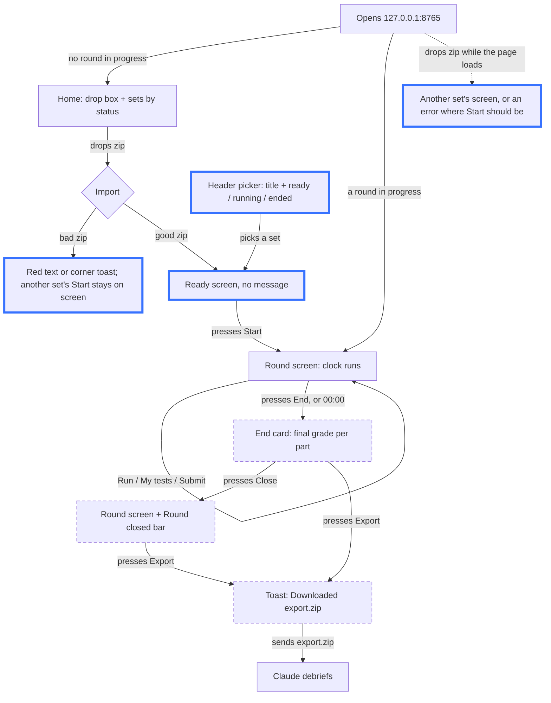
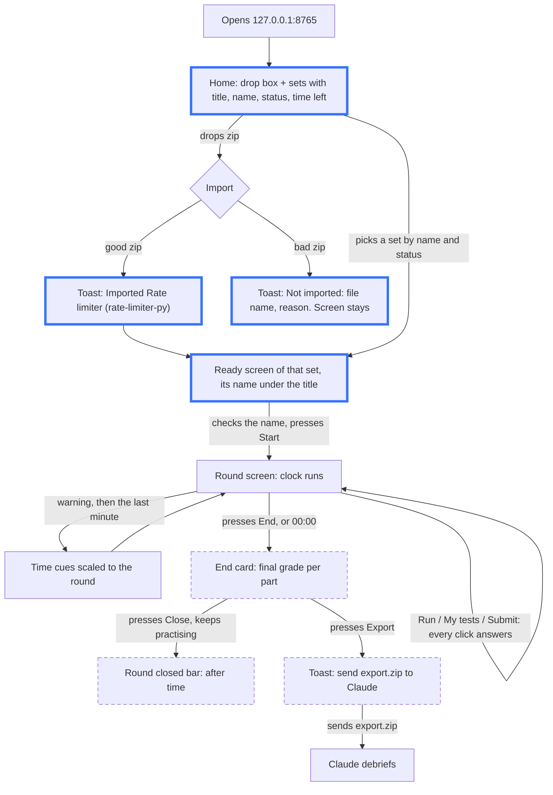

# Interview Lab: product doc

Status: written 2026-11-25 from the round-1 usage tests (a candidate in a browser), the owner's own timed round, and a read of the code at `origin/main` (e537022).
Every claim about today's behaviour names the file and function it comes from.

## 1. Problem and goals

Interview Lab is for one thing: practising coding interviews on your own. Practising alone fails in two ways: the
practice is not realistic (no clock, no hidden tests, the problem visible in advance), or the feedback is not honest
(you grade yourself, you forget what happened at minute 12). Interview Lab is a local, Docker-only practice app: pick a
problem from its catalog, take a realistic timed round, get honest results, practise again.

Goals, in priority order:
1. **Honest results.** Every number the candidate sees (time left, N/M passed, "after time") is true. A round that
   ended on time reads on time; work done after the round reads as after the round.
2. **A realistic round.** Nothing about the problem or tests leaks before Start or during the round; the clock is real.
3. **One practice loop.** Pick a problem → ready → Start → code → close → honest results → pick the next one or retake.
   Each step tells the candidate what to do next.
4. **Company- and role-agnostic.** The app shows only what the set brings; it never knows about any company or role.

Non-goals: hosting, accounts, multi-user, scoring candidates against a real platform, an AI tutor inside the app.

## 2. Personas

One persona: the candidate. (The interviewer-agent persona was removed by the owner on 2026-11-26.)

**Candidate** (the owner). Wants a realistic timed round with honest results and no leaks. Works in a browser at
1440×900 and sometimes a narrow window. Under pressure: every click must give a visible answer, and the screen must say
plainly what counts and what doesn't. Will practise after time sometimes, and wants that labelled, not blocked.

## 3. Ideal end-to-end workflow

### Candidate
1. Opens http://127.0.0.1:8765. Sees a home screen: the drop zone and a list of sets that says which is which (title,
   name, language, status, time left). Nothing stale pops up.
2. Drops the zip. A message confirms "Imported <title> (<name>)" or says exactly why not, and the screen stays put on a
   failure.
3. Ready screen: company/role/round/language/difficulty/minutes and rules from the manifest. No problem text. Start.
4. Round: the clock runs; the editor opens the file to work in; Run, My tests, Submit each answer every click (even a
   repeat), My tests shows its file pattern up front. Parts unlock with a clear cue.
5. Time cues scale with the round (a warning near the end, a last-minute cue).
6. The round closes at **End or at 00:00, whichever comes first**. Closing grades the code one last time and shows the
   final result. The candidate can keep practising; everything after the close is visibly marked "after time".
7. Export saves `export.zip` and says where it went and what to do with it ("send it to Claude").

## 4. Ideal information architecture

```
Home ─ drop zone + set list (title · name · language · status · time left)
 └─ Ready (per set): eyebrow company·role·round, title, pills (language, difficulty, minutes), rules, Start
     └─ Round
         header:  set identity · part chips · timer (one clock, warning scaled to the round)
         toolbar: Run · My tests (pattern) · Submit (the one accent) · Next part · End  |  busy · saved · Export
         status:  after the close, one bar: "Round closed at mm:ss. Anything you run now is marked after time."
         panes:   Files | Editor + stdin/results | Problem (parts appended with "Part n unlocked at mm:ss")
         dialogs: End confirm · Next-part confirm · Final card (title, final grade per tag, timeline, Export, Close)
         toasts:  every action that has no other visible result (import, export, repeat clicks)
Data (per set, data/sets/<name>/):
  manifest.json, problem.md, .hidden/       from the zip (never shown before Start / never shown)
  work/                                     the candidate's code (autosaved)
  session.json                              clock + event log (the timeline)
  results.json                              latest grade per tag + "final" (the official close)
  final/                                    the code as it was at the close (planned, round 1)
  data/exports/<name>-<ts>.zip              every export
```

## 4a. User flows

The candidate's flow as it works today, then the ideal from §3. Drawn from the code on `main` (6003d09) and the round-1
usage test (A-report). Screen names are the ones a user sees.

Legend for every diagram: **thick blue border** = round 2 ("Drop to ready", `docs/rounds/2-drop-to-ready/`) changes
this step; **dashed border** = round 1 ("Honest round close") already fixed it. Unmarked steps that differ between
today and ideal are for later rounds.

### Candidate: today


Thick blue: round 2 changes it. Dashed: round 1 fixed it.

### Candidate: ideal


Thick blue: round 2 changes it. Dashed: round 1 fixed it.

**The drop gives no answer (round 2).** The candidate drops Claude's zip. Today the screen just changes to a ready
screen, and dropping the same unstarted zip again changes nothing visible (A-31). It should say "Imported Rate limiter
(rate-limiter-py)", or "…replacing the copy you hadn't started".

**A failed drop looks like a success (round 2).** The candidate drops a broken zip while another set is open. Today that
set's ready screen and Start button stay, under a red corner toast with author-speak (B-E-e2a-error, A-28). It should
say "Not imported: <file name>." with a plain reason and leave the screen as it was.

**Sets look alike (round 2).** The candidate opens the header picker to find the set Claude just sent. Today every copy
reads "Rate limiter · ready" (A-03), and the ready screen never shows the name. The picker should show the name and
"not started" or "N min left", and the ready screen the name under the title. Home rows already show the name, and
the Home page (#10) already stopped the stale end card from opening on first load.

**A drop while the page loads can lose (round 2).** With a round in progress, the candidate reloads and drops a new zip
in the first second. Today the app's own reopening of the round can finish last and land on the new set as an error.
The latest thing the candidate did should win.

**My tests gives no hint before it fails (later).** The candidate writes `mytest.py` and presses My tests. Today they
learn the `test_*.py` pattern only from the failure (A-13). The button should show the pattern up front.

**The clock gives no cues (later).** The candidate is in a 2-minute round. Today the timer is yellow from the first
second and nothing marks the last minute (A-25). Cues should scale with the round.

**Finishing every part is a dead end (later).** The candidate passes every part. Today Next part disappears and nothing
says what to do (A-35). The screen should say "All parts pass. End now, or keep polishing."

## 5. What exists today (bottom-up)

**Runner and grading** (`backend/sandbox/runner.py`, `backend/sandbox/grade.py`). One container per Run/Submit with the full lock-down
(no network, read-only root, tmpfs, 512 MB, 2 CPUs, 256 pids, cap-drop ALL). Verdicts Accepted / Wrong Answer / Compile /
Runtime / TLE / MLE with time and peak memory. Grading for Python (pytest), Go, Java (mini-runner), TS/JS (`node:test`),
per tag, with `last_error`/`last_line` and Go/Java pruning of later levels. Fast (Run ~50 ms, grade ~1.2 s per B).

**Set format and validation** (`tools/pack.py` `validate`, shared by the importer). Field-level messages; refuses
`reference/`, `mutants.json`, `bugs.json`. Does not check reveal chains (duplicate `unlocks`, same file twice) or that
tags match any test.

**Backend API** (`backend/server.py` routes; `backend/lab/` import, storage and round actions). Import (drag-and-drop only, zip safety checks, replaces an unstarted set
silently, refuses a started one with a clear message); ready info without the problem; Start; state; files GET/PUT;
Run; My tests; Submit (per unlocked tag, reveals on pass); Next part; End (one last grade into `results.json` `final`);
Export (`submission/` = `work/` now, plus `session.json`, `results.json`, `manifest.json`; a copy kept in
`data/exports/`). Clock: `clock()` uses wall time from `start`; `over()` = `ended` **or** time expired; `log()` appends
`" (after time)"` when `over()`; `stamp()` sets `after_time: over()`.

**UI** (`ui/src/App.svelte` shell, `ui/src/nav.js` navigation, `ui/src/features/<screen>/`, `ui/src/components/`, `ui/src/lib/`, `ui/src/styles/`; Svelte, built by Vite in `deploy/nginx/Dockerfile`). Home (first load, or "All sets"): drop zone + sets grouped In progress / Not started / Finished
(title, name, round, language); first load resumes a round in progress, else stays home. Header picker of `title · status`; ready
card; round screen with Monaco, file tree, new-file input, stdin, results pane, problem pane, part chips, timer (yellow
at ≤5 min, red at 0); inline confirm bars for Next part and End; final card with grade rows, "Where the time went" and
Export; toast. Theme Auto/Light/Dark. Keyboard Ctrl+' / Ctrl+Enter. At 00:00 the UI only polls and shows the final card
titled "Time's up" with the latest Submit results (`tick()` → `showFinal()`); nothing is graded and nothing closes.

**Skill and docs.** `SKILL.md` (549 lines) builds/gates/packs sets, tells Claude to compute time from `session.json` by
formula ("if `ended` is set, time is over"), and to re-grade `submission/` for the debrief. `tools/status.py` exists and
is documented only in README. FORMAT.md and API.md match the code's shapes.

**Tests.** `tests/api_test.py` (languages, limits, leaks, grading flows, import validation, security); `tests/e2e.spec.mjs`
(one full flow: drop → ready → Start → Run → Submit → reveal → End → Export); `tests/e2e.sh` asserts the export
contents and that the event log has no "(after time)". No test covers the clock boundary, time up, or `after_time`.

### Features that exist but don't connect into one workflow
1. `results.json` `final` already holds the official grade with failed names, but the skill's debrief ignores it and
   re-grades `submission/`, which needs hidden tests the export does not contain.
2. `submission/` in the export is the code at export time, so practice after the close flows into the debrief as if it
   were the round.
3. `data/exports/<name>-<ts>.zip` is written on every export; neither the UI nor the skill mentions it, so a Claude Code
   user is asked to upload a file Claude could read in place.
4. `tools/status.py` computes time left correctly (it uses `ended` as "now"); the skill re-derives the formula by hand and
   reads `ended` as "time is over".
5. `session.json` has a `hints` array the app never writes; the skill logs hints to `$W/hints.log`, so the debrief
   timeline is stitched together by hand.
6. The "(after time)" mark exists in the event log, and `after_time` exists on every grade, but the round screen and the
   grade rows never show it; only the final card's timeline does.
7. The server allows Next part after End (`next_part()` has no `ended` check) but `state()` sets `has_next` false and the
   UI hides the button, so a Levelled candidate cannot keep practising the next level after the close.
8. `last_line: "no files match <pattern>"` exists for My tests, but the pattern is never shown before the click, and a
   repeat click renders identical HTML, so the screen does not change.
9. The set `name` is the identity the skill, the data folder and the error messages use, but the UI never shows it.

## 6. Gap analysis

| Ideal | Today | Gap |
|---|---|---|
| Round closes at End or 00:00 with one final grade | Only End grades; 00:00 shows the last Submit or "No results. Nothing was submitted." | Time up is not a close (F2) |
| On-time results read on time | `final.*.after_time` is always `true` (F1); Submits that start in time but finish late are "after time" (F4) | Stamps use the wrong moment |
| Work after the close is marked on screen | Only in the final card timeline | No round-screen state for "closed" (F2) |
| Debrief sees the code as at the close | Export has the code at export time (F3) | No snapshot |
| Every click answers | My tests repeat, Export, import success give no visible change (F5, F6, F9) | Missing feedback |
| Sets are identifiable | Picker shows titles only; stale final card on first load (F8) | Identity |
| Agent reads truth without re-deriving | Skill hand-computes time, misreads `ended`, re-grades without the tests (F7, F13) | Skill/doc drift |
| Pack/gate catch manifest mistakes | Reveal chains and tag coverage unchecked (F12) | Validation |
| Usable at ~400 px | Editor 5 lines tall, problem below everything (F14) | Layout |

## 7. Findings, worst first

Ranked by persona impact: does it make results or the debrief untrue (both personas), does it break the round, how often
it bites. Each was checked against the code; reframed items say so.

**F1. Every final grade says `after_time: true`, even on an on-time End.**
Where: `backend/server.py` `end()` sets `ended` first, then `stamp()` computes `after_time: over(s)`, and `over()` is true
whenever `ended` is set. Evidence: B saw `results.json` `final.test_.after_time == true` after an End at 3.4 of 45 min.
Impact: both personas. The skill's rule "say which results came after time" turns every on-time round into a late one in
the debrief. The official result of every round is wrong.

**F2. Time up does not close the round, does not grade, and post-time work is unmarked on screen.**
Where: `ui/app.js` `tick()` → `poll().then(showFinal)`; `showFinal()` falls back to `st.results`; no server call at 00:00.
Evidence: A-26 "Time's up / No results. Nothing was submitted." with code in the editor; A-18..21 Run, Submit, edit all
live after Close with nothing saying they are after time; the End dialog itself promises "Hidden tests run one last
time". Impact: candidate cannot tell what counts; agent cannot "report what passed within time" when the candidate never
pressed Submit. Reframed: practising after time is allowed by the skill (rule 4), so the fix is to close, grade and label,
not to lock the editor.

**F3. The export's `submission/` is the code at export time, not at the close.**
Where: `server.py` `export()` writes `work_files(n)` as of now. Evidence: A practised and Submitted after time, then
exported; B's debrief re-grades `submission/`. Impact: agent; the debrief reviews and re-grades post-time code as the
round.

**F4. The close is not atomic, and stamps use the wrong moment.**
Where: `server.py` `end()` reads `session` outside the lock, so two Ends both pass the `ended` check; the second logs
"end (after time)" (its `log()` runs after `ended` is set), re-grades and overwrites `final` and `ended`. `end()` sets
`ended` before `busy()`, so an End during an in-flight Run/Submit returns 409 with `ended` set and `final` never written;
a retry returns early. `submit()`/`run()`/`mytests()` stamp and log after the runner returns, so a Submit pressed at
29:50 that grades for 15 s is "after time". `clock()` keeps counting after End, so `state.left_s` and `expired` drift.
Evidence: the owner's event log wrote "end (after time)" 0.1 min into a 30-min round; a single End cannot produce that in
today's code (`log("end")` runs before `ended` is set), a second concurrent End can. Impact: both; the timeline the
debrief reads is untrue, and the auto-close planned for F2 would hit the in-flight case at every 00:00 Submit.

**F5. My tests gives no visible answer on a repeat click, and hides its file pattern until it fails.**
Where: `ui/app.js` `doMyTests()` re-renders identical HTML; `index.html` button text is just "My tests"; the pattern
lives only in `manifest.your_tests`. Evidence: the owner's `session.json` logged "my tests: no tests selected" 10 times in
one minute; A-13 shows `no files match test_*.py` only after the click. Impact: candidate, mid-round, under time pressure.

**F6. Export gives no confirmation or next step.**
Where: `ui/app.js` `doExport()` triggers a download and nothing else. Evidence: A-24 identical to A-23; B looked for the
top-bar button, which is behind the final card (by design: the card is a modal with its own Export). Impact: both; the
hand-off to the debrief is where the loop breaks.

**F7. The debrief cannot run from the export alone.**
Where: export has no hidden tests (correct: they must not reach the candidate); SKILL.md "Debrief" says re-grade
`submission/` but not against what; README's re-grade command points at `/c/<hidden tests>` inside the export dir.
Evidence: B-report finding 2. Impact: agent; in a fresh conversation the re-grade is impossible. Connects to item 1 above:
`final` already has the names.

**F8. Sets are indistinguishable, and first load can open a stale final card.**
Where: `loadSets()` option text `title · status`; `openSet()` reopens `ilab-last` and `enterRound()` calls `showFinal()`
for an ended set. Evidence: A-01 (someone else's finished round on first load), five identical "Rate limiter" entries,
two "Turnaround rooms (DSA)" for B. Impact: both; a candidate can start the wrong set.

**F9. Imports give no success message; a failed drop leaves an unrelated set on screen.**
Where: drop handler → `loadSets(name)` with no toast; `do_import()` silently replaces an unstarted set; on failure only
`flash()` if a set is open. Evidence: A-02, A-31, B finding 5; A-28 error text is author-speak. Impact: candidate.

**F10. Finishing every part is a dead end.** Where: `renderParts()`/`setState()`; Next part vanishes when nothing is
locked. Evidence: A-35. Impact: candidate.

**F11. The timer warning ignores round length.** Where: `tick()` `left <= 300`. Evidence: A-25 (2-minute set is yellow
from the first second); no cue at 1:00 or 0:30. Impact: candidate.

**F12. Reveal chains and tag coverage are not validated.** Where: `pack.validate()` (shared by import); gate does not
read the manifest. Evidence: B cases C1-C3 packed and imported silently. Impact: agent; mistakes surface mid-round.

**F13. Skill drift.** Where: SKILL.md "Clock" (formula by hand, "if `ended` is set, time is over"), no mention of
`tools/status.py`; mid-round names: `results.json` holds `failed` for the interviewer (B finding 7, reframed: the
no-names rule is about the candidate's screen; the skill should say Claude must not relay names); 270 lines of helper
heredocs not needed in Claude Code. Impact: agent.

**F14. Narrow window is barely usable.** Where: `style.css` `@media (max-width: 900px)` stacks files, editor, problem.
Evidence: A-36. Impact: candidate on a small window.

**F15. Editor opens `run_entry` (often the "complete" file) and reload forgets stdin and the last results.** Where:
`enterRound()` `first = run_entry || files[0]`. Evidence: A-04, A-34. Impact: candidate, small.

**F16. Results pane is cramped for Run output.** Where: `doRun()` table with stdout/stderr in "Got"; `#bottom` 36%
height. Evidence: A-07. Impact: candidate.

**F17. Small copy and polish.** "NEW PART · 1.1 MIN" reads as a duration (`renderProblem()`); object reprs with hex
addresses in assertions; compile errors without file/line for Python (`grade.lastline`); new files cannot be renamed or
deleted; Ctrl+M focus-trap hint missing; gate's "mutant killed [all]" message on a survivor. Evidence: A 10-15, B 10.

Dropped: B 11 (Playwright start-up time is test infrastructure, not product); B 13 (writing through the API is the
documented interviewer path); A's IndentationError when typing via Playwright `insertText` (tooling artefact, not seen by a
human typist).

## 8. Roadmap

Round 2 (planned, `docs/rounds/2-drop-to-ready/`): **Drop to ready**. It takes the import half of "Every action
answers" (F9, A-report finding 13), "Set identity" (the picker half of F8; Home (#10) fixed the stale card), "Manifest
sanity" (F12) and the round-1 follow-up about a drop during page load. My tests (F5) and timer cues (F11) stay in Now.

### Now: honest and coherent

| Item | Effort | Design doc | We'll know it worked when |
|---|---|---|---|
| **Honest round close** (round 1: F1, F2, F3, F4, the close half of F6, the Clock/Debrief half of F13) | M (5 PRs) | yes | A round ended on time exports `final.*.after_time: false`; 00:00 closes and grades by itself; every post-close action reads "after time" on screen and in the data; a double End logs one "end"; the export carries the code as at the close |
| Every action answers (F5, F9, export toast if not in round 1) | S | no | Ten My tests clicks give ten visible answers; the pattern is on the button; every drop ends in a toast naming the set or the reason |
| Set identity (F8) | S | no | The picker shows title, name, status and time left; first load never opens a stale final card |
| Timer cues scale with the round (F11) | S | no | A 2-minute set is not yellow at Start; there is a cue at 1:00 |

### Next: connect the features

| Item | Effort | Design doc | We'll know it worked when |
|---|---|---|---|
| Debrief kit (F7, F13, connect items 1, 3, 4, 5) | M | yes | Claude debriefs from `export.zip` plus the kept set with no hand-written scripts; in Claude Code it reads `data/exports/` and `tools/status.py` directly; hints appear in the timeline |
| Manifest sanity in pack, import and gate (F12) | S | yes (short) | B's cases C1-C3 fail at pack time with a message naming the field; a tag no hidden test carries fails the gate |
| Finish state (F10) | S | no | With every part passing, the round screen says "All parts pass. End now, or keep polishing" |
| Narrow layout (F14) | M | yes | At 400 px the problem, editor and results are each one tap away and the editor is at least half the viewport |
| Editor and results ergonomics (F15, F16) | S | no | The editor opens the file the candidate edits; a failing Run shows the traceback outside the table |

### Later: close the loop

| Item | Effort | Design doc | We'll know it worked when |
|---|---|---|---|
| Round history: a local list of past rounds (type, language, final per tag, after-time share) the skill reads to choose the next round | M | yes | The skill's next-round suggestion cites past results without the user re-uploading exports |
| Archive sets (hide from the picker, never delete `data/`) | S | no | The picker shows only live sets; archived ones are restorable |
| Skill split: Claude Code path vs claude.ai path, helpers only where needed (F13 length) | M | yes | SKILL.md under 350 lines; B's Claude Code run uses no hand-written helper |
| Copy and polish pass (F17) | S | no | Each A 10-15 item verified fixed on the running app |

## What shipped

### Round 1: Honest round close (2026-11-25)

**Theme and why.** The app's one job is to tell the truth about a round, and at the close it didn't: every final grade was stamped "after time" (End set `ended` before `stamp()` checked it), 00:00 neither closed nor graded the round, two racing Ends could log "end (after time)", an End during a Run never wrote `final`, Submits were stamped when grading finished, and the export's code included practice after the close. Chosen over "every action answers" (friction, not wrong results) and the "debrief kit" (needs correct flags first).

| PR | What it does |
|---|---|
| #1 | Product doc (this file) and the round's SPEC/HLD |
| #4 | Actions are stamped when they start; End is one idempotent close that waits for an in-flight Run/Submit; a close after the deadline logs "time up" with `ended` = deadline; the clock freezes at the close; the final grade's `after_time` = code edited after the deadline (+5 s) |
| #6 | The code at the close is snapshotted to `final/` and exported beside `submission/`; Next part stays available after the close (marked after time) |
| #2 | Export answers with a toast, re-shown visibly on every click |
| #5 | 00:00 closes and grades the round; the end card shows the final grade ("Time's up" / "Interview ended", "Closed at mm:ss of N min"); a "Round closed" bar stays; later results say "after time"; the timer freezes with the label "closed" |
| #3 | SKILL.md and README: time from `tools/status.py`, results from `final`, debrief re-grades `final/` against the kept set; the README re-grade command runs as written |

**How it was verified** (on the running stack, each PR built from its branch, then `main` after merging):
- `tests/api_test.py`: 183 PASS, 0 FAIL, including the new "honest clock" (on-time End, parallel Ends → one close, End during Submit, "time up" at 1.0, edit after deadline → final after time) and "final snapshot" sections.
- `tests/e2e.sh`: `2 passed` (main flow + new "time up closes the round"), export contains `final/`; rerun from `main` after release.
- In a real browser at 1440 px and 400 px, light and dark: 1-minute round closes itself with a real final grade; early End freezes the clock at 29:57 labelled "closed"; the closed bar stays; a Submit after the close shows "after time" while final rows don't; Next part says "It is marked after time"; no horizontal scroll.
- Export toast: a repeat click animates opacity 0 → 1 (it first failed with no visible change and went back to the builder).
- `tools/status.py` on a round closed by "time up" prints `used_min 1.0`; the README re-grade command graded an export's `final/` against the set folder.

**Decisions defaulted for the owner:** 00:00 closes and grades automatically (End is not required); `submission/` keeps its meaning and `final/` is added; 5 s grace for the final grade's after-time flag; End waits for an in-flight Run/Submit.

**Still open:**
- Every action answers (F5, F9): repeated My tests clicks with no test files still look identical (the owner's round logged 10); imports have no success confirmation; the picker shows titles, not set names.
- Debrief kit (F7): the export has no hidden tests, so a debrief needs the kept set folder.
- Found during verification: dropping a zip within ~1 s of page load can be overridden by the app's own first load of the last-used set. (Tests now run on their own throwaway stack, `tests/stack.sh`, so they no longer leave `t-*` sets in the user's picker.)
- 400 px layout: the editor is very short (pre-existing).
- The synced copy of the skill under `~/.claude/skills/synced/` needs refreshing by the owner.

### Round 2: Drop to ready (2026-11-25)

**Theme and why.** Getting the right set on screen is the one step a candidate can't undo: once Start is pressed, the clock runs and that set can't be imported again under its name. Before this round a good drop said nothing, a bad drop left the previous set's Start button on screen, copies looked identical in the picker, a drop in the first second after a reload could lose to the app's own first load, and `pack.py` packed sets that could never work. During the round the owner added five more changes from real use (PRs 6–9 and the confirm step in PR 1).

| PR | Before → after |
|---|---|
| [#15](https://github.com/TheModerateCow/interview-practice/pull/15) | Plan: SPEC, HLD, and §4a user flows (Candidate and Interviewer agent, today vs ideal) |
| [#17](https://github.com/TheModerateCow/interview-practice/pull/17) | `pack.py` printed `packed 7 files` for a set whose Part 3 can never pass → `NOT PACKED:` naming the field; the importer refuses the same zip |
| [#18](https://github.com/TheModerateCow/interview-practice/pull/18) | A drop during page load showed "Cannot read properties of null" where Start should be → the dropped set opens, every time; a drop during a round asks "Open <file>? Your round keeps running…" first (Stay is the default) |
| [#16](https://github.com/TheModerateCow/interview-practice/pull/16) | Picker read "Rate limiter · running" / "Rate limiter · ready" → "Rate limiter · rate-limiter-b · 30 min left" / "… rate-limiter-py · not started"; the ready screen shows the set's name |
| [#20](https://github.com/TheModerateCow/interview-practice/pull/20) | A drop said nothing, or "Import failed: invalid set: format: …" → "Imported Rate limiter (rate-limiter-py)." / "Not imported: file.zip. This zip is not a valid Interview Lab set. Ask Claude to pack it again." |
| [#22](https://github.com/TheModerateCow/interview-practice/pull/22) | Files, Problem and stdin/results had fixed sizes → drag any of the three borders (or Tab + arrows); sizes are remembered |
| [#21](https://github.com/TheModerateCow/interview-practice/pull/21) | No way to remove old sets → "Delete" on Home for unstarted and finished sets; the folder moves to `data/deleted/`, nothing is erased |
| [#23](https://github.com/TheModerateCow/interview-practice/pull/23) | Run on a Go library showed `/tmp/w/prog: 2: Syntax error` → "Nothing to run: this code is a library (package flagstore)… Check it with Submit." |
| [#24](https://github.com/TheModerateCow/interview-practice/pull/24) | Each unlocked level was appended under the last, after "New part · 1.1 min" → one tab per unlocked level; the new one opens by itself |
| [#19](https://github.com/TheModerateCow/interview-practice/pull/19) | The skill said "drag it in, press Start" → check the "Imported <name>" message first; every set must give a way to check code besides Submit (`your_tests`, and a `run_entry` for levelled/codebase rounds) |

**How it was verified.** Every PR was built and tested on the isolated test stack (`tests/stack.sh`, port 8766), never on the owner's app.
- #17, #18 and #16 were verified by the lead before merging: `tests/run_all.sh` on `main` plus each PR in merge order (every step PASS once #18 was in; it fixed an e2e failure already on `main`), the examples walked, and the confirm bar, picker and ready screen checked at 1440 and 400 px in light and dark (no sideways scroll). Their PR bodies carry before/after screenshots.
- #20, #21, #22, #23 and #24 passed their builders' full runs. The owner asked to merge the rest without the lead's separate runs, so the lead resolved the merge conflicts (test files, `App.svelte`) and ran `tests/run_all.sh` once on the final `main` (8a07216): every step PASS, 5 gates, api_test ALL PASSED (243 checks), e2e 5 passed (full flow, time up, drop during page load, Home delete, panes).

**Decided by the owner:** a drop during a round asks first; the lead merges verified PRs; delete is a soft delete into `data/deleted/`.

**Still open:**
- Autocomplete: Monaco ships language services only for JS/TS (and JSON/CSS/HTML). Python, Go, Java and C get "words already in this file" only. Options: say so on the ready screen; keyword lists; an in-browser Python analyser; language servers in the backend.
- `pack.py` doesn't yet refuse a levelled or codebase set without `run_entry` or `your_tests` (the skill now asks for them; nothing enforces it).
- One shared test stack makes every full run wait its turn (6–13 min each). Let `tests/stack.sh` run several stacks at once (own name and port per run).
- The 400 px layout still squeezes the stdin box (F14).

### Round 4: Choose the language, and Settings (2026-11-27)

**Theme and why.** The owner said the Go / Java / Python pills on Home "look like a label and not an actual button": nothing on them responded to the pointer, and nothing said which language a row click would open. It was the first thing a candidate touches, so it went first. During the round the owner added Settings (word wrap, then the theme switch and a way to hide the timer), a spacing fix in the problem text, and the worst finding from the round's candidate usage test (Run ran the open tab).

| PR | Before → after |
|---|---|
| [#37](https://github.com/TheModerateCow/interview-practice/pull/37) | The product doc had two personas → one, the candidate; the app is described as a practice tool |
| [#40](https://github.com/TheModerateCow/interview-practice/pull/40), [#41](https://github.com/TheModerateCow/interview-practice/pull/41) | Plan: SPEC and HLD in `docs/rounds/4-language-pick/` |
| [#43](https://github.com/TheModerateCow/interview-practice/pull/43) | Each row ended in three outlined pills that looked like tags; a row click opened a language nothing named → one "Practise in [Go \| Java \| Python]" switch above the list, the chosen one filled; every row says "Levelled round · Python · Hard · 90 min"; the choice survives a reload; at 400 px titles wrap to 2 lines instead of 4 |
| [#42](https://github.com/TheModerateCow/interview-practice/pull/42) | No settings, long lines ran past the editor's edge, the theme switch sat in the header → a Settings panel from the header's last button, over the current screen (the clock keeps running): Word wrap Off / On and the theme switch |
| [#46](https://github.com/TheModerateCow/interview-practice/pull/46) | The countdown was always on screen → Settings › Timer: Hide shows "Timer hidden"; the set picker says "in progress" instead of minutes left; the round still closes at 00:00 |
| [#39](https://github.com/TheModerateCow/interview-practice/pull/39) | "Level 1: catalog and carts" sat right under the paragraph before it (0 px) → 32 px above section titles, 24 px above sub-headings |
| [#44](https://github.com/TheModerateCow/interview-practice/pull/44) | With `alerting.py` open, Run said "Accepted · No output" and skipped the samples → Run always runs the run program (`main.py`) and shows "Testcases · n/2 passed" |

**How it was verified.** Every PR was built and tested on the isolated test stack (port 8766), never on the owner's app.
- Each PR: `tests/run_all.sh` on its branch, every step PASS (5 gates, api_test ALL PASSED, e2e 7–8 passed), and its example clicked through in Chromium with before/after screenshots in the PR body. #39 and the second commit of #46 ran `tests/e2e.sh` only (UI-only changes).
- Lead walks: #43 Java chosen → every row says Java → still chosen after reload → Bank ledger opens `banking-levelled-java-1` with no clock; #42 clock 00:59 → 00:56 with Settings open, wrap kept after reload, at 00:00 Settings closes and the end card shows; #44 `alerting.py` open → Run sends `main.py`; #46 no countdown element while hidden, picker "in progress".
- `main` at 3c2dd12 (after #44 and the round 5 plan) passed `tests/run_all.sh`; released 2026-11-27 after the owner's round ended (build at 1915fbd, nginx serves "Practise in", "Timer hidden", word wrap and the new heading spacing).

**Decided by the owner:** the candidate is the only persona and the app is for practice; build without design sign-off; the theme switch moves into Settings; isolated test runs may happen during a live round (only redeploys wait). **Defaulted:** Python is the first-visit language; imports in one language stay listed ("Python only") whatever "Practise in" says; Settings is a panel, not a screen.

**Still open** (round 4 candidate usage test, `.iteration/work/round-4/A-report.md`, worst first):
- A slow solution shows only "did not finish in 45 s" with no pass count; leaving mid-Submit leaves "another Run/Submit is still running" with no timer.
- Finished attempts carry no score, date or duration, sit collapsed below the catalog, and nothing suggests what to practise next.
- Opening a ready screen creates an attempt ("Not started" ghosts); clicking a tried problem opens a new copy, not the old one.
- Results and stdin vanish on leave or reload.
- 400 px round screen: editor ~5 lines; the problem text draws over the results.
- Ready screen: no Run vs Submit, no 0:00 behaviour; "Hints are free: ask in the chat" names a chat the app doesn't have.
- The owner's own round: Submit said "test_l1_ could not be graded" 12 times in a row in Go (likely code that didn't compile); it should say why.
- Round 5 (`docs/rounds/5-editor-intellisense/`, plan merged in #45): real code help for Python, Go and Java; in progress.
